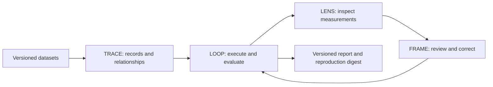

# NUROWERX / RESEARCH STACK

[](https://doi.org/10.5281/zenodo.23898164)

**TRACE · LOOP · LENS · FRAME — From information to understanding.**

An open-source research platform connecting information provenance, AI evaluation, scientific visualization, and human judgment. Version 0.1.1 is a local, working research workbench with deterministic synthetic evaluation targets, inspectable records and reproducible reports.

[Source](https://github.com/Nurowerx/research-stack) · [Releases](https://github.com/Nurowerx/research-stack/releases) · [Installation](docs/installation/README.md) · [Papers](research/papers/README.md) · [NRS-Bench](datasets/README.md) · [Validation](docs/validation/README.md)


| Module | Implemented capability |
|---|---|
| TRACE | Typed evidence records, version history, graph traversal, claim assessments, content verification and atomic graph exchange |
| LOOP | Executed deterministic policies, explicit scoring denominators, reviewed corrections, affected/full reruns and paired comparisons |
| LENS | Evidence-linked charts, shared filtering, source data tables, missing-value handling and SVG exports |
| FRAME | Integrated research console, evidence inspection, annotation history, saved layouts and report preview/export |



## Start locally

Requires Python 3.11, Node.js 24 and Git. From the repository root:

```sh
python -m venv .venv
# Windows PowerShell: .venv\Scripts\Activate.ps1
# Linux/macOS: source .venv/bin/activate
python -m pip install -r requirements-lock.txt
python -m pip install -e . --no-deps
npm ci
npm run build
nx-stack init
nx-stack seed
nx-stack serve
```

Open http://127.0.0.1:8876. Select a failed `revision-000` result, propose `prefer_latest`, record an accepted review, rerun the affected case, then compare and export the report. The browser suite executes this workflow. Review actor names are labels, not authenticated identities.

```sh
python -m pytest -q
npm test
python scripts/benchmark.py --output results/nrs-bench
nx-stack reproduce --report examples/model-evaluation/corrected-affected-report.json
python scripts/clean_install.py --destination ../nrs-clean-check
```

The clean-install destination must be new and outside this checkout. The script installs dependencies, runs backend/chart/browser tests, executes NRS-Bench, starts production and development services, and verifies the exported semantic digest. See [reproduction boundaries](docs/reproducibility/README.md).

## Research evidence

The original 31-test baseline is retained separately. The v0.1.0 suite expanded to 35 backend, 12 visualization and 7 browser tests; raw executed evidence is indexed in [validation](docs/validation/README.md). v0.1.1 adds release-packaging controls; its exact-commit verification and fresh CI/reproduction artifacts are attached to the GitHub release. NRS-Bench runs three seeds and 18 evaluations. On each 60-case development split, first-match obtains 10/60 correct, evidence-aware 60/60, and a reviewed prefer-latest full rerun 30/60. The affected-case result is 1/1 and is not used as a full-split estimate. These are finite synthetic tasks, not language-model capability measurements or real-world accuracy estimates.

The papers document architecture, evaluation and benchmark construction. Public Palantir repositories are pinned [design references](research/references/README.md); NRS includes no Foundry dependency or enterprise dataset. There is no measured head-to-head Palantir comparison.

## Scope and citation

This release does not establish human-user outcomes, general AI reliability, cryptographic authorship or independent-party replication. A hard interruption leaves an explicit running record requiring manual investigation. The interface uses bounded views; the stress fixture does not establish production capacity. SQLite is the validated storage target. [Security](SECURITY.md) describes access and integrity limits.

Cite Spencer H. Walker, *Nurowerx Research Stack*, version 0.1.1, Nurowerx, 2026, https://github.com/Nurowerx/research-stack. Machine-readable metadata is in [CITATION.cff](CITATION.cff) and [codemeta.json](codemeta.json). The v0.1.1 release is available on GitHub; no version-specific Zenodo DOI is claimed for it. Software v0.1.0 is archived on Zenodo: [10.5281/zenodo.23898164](https://doi.org/10.5281/zenodo.23898164), from the [SWALKERNURO release](https://github.com/SWALKERNURO/research-stack/releases/tag/v0.1.0). All-version DOI: [10.5281/zenodo.23898163](https://doi.org/10.5281/zenodo.23898163). Separate dataset and paper DOIs have not been issued.

Software: **MIT**. Original datasets and papers: **CC BY 4.0**. Third-party dependencies retain their own licenses. [Contributing](CONTRIBUTING.md) · [Governance](GOVERNANCE.md) · [Documentation index](docs/README.md).

## Read-only demonstration

The [static demonstration](https://nurowerx.github.io/research-stack/) presents recorded synthetic experiment results with seed selection and links to raw reports. It does not run the complete backend. [Container instructions](docs/installation/README.md#container) support local use of the full application.
